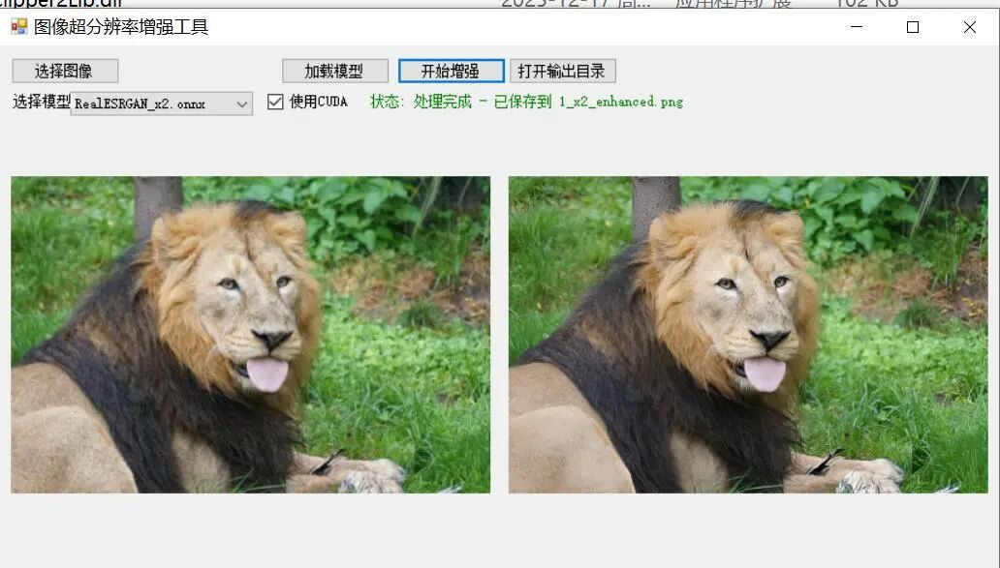

# Implementing Super-Resolution Image with Lossless Zoom and Blurred Images Cleared by Deploying RealESRGAN's ONNX Model Based on C# Winform

# Implementing Super-Resolution Image with Lossless Magnification and Blurred Images Cleared by Deploying the RealESRGAN model on C# Winforms

This is a demonstration of a Windows desktop application based on the RealESRGAN algorithm for image super-resolution enhancement. The project was developed using C# WinForms, and the RealESRGAN model was loaded through ONNXRuntime to achieve high-quality image enlargement and detail reconstruction.

### Effect Display



Insert image description here.

### Algorithm Principles

#### RealESRGAN Introduction

RealESRGAN (Real-World Enhanced Super-Resolution Generative Adversarial Networks) is an algorithm for super-resolution reconstruction of real-world images:

-

• **Generative Adversarial Network (GAN)**: Utilizing the generator-discriminator architecture, the generator is responsible for reconstructing high-resolution images, while the discriminator evaluates the authenticity of the images.

-

• **ESRGAN Foundation**: Improved on the ESRGAN foundation, specifically optimized for degraded images in real-world scenarios.

-

• **High-order Degradation Simulation**: Training through simulating complex image degradation processes in the real world (blurring, noise, compression artifacts, etc.).

-

• **U-Net Discriminator**: Using a U-Net structured discriminator to provide realism judgment at the pixel level.

#### Processing Procedures

1.

1. **Image Preprocessing**: Convert the input image to FP32 floating-point type and normalize it to the range [0, 1].

1.

2. **Dimension Transformation**: Convert the image from HWC (Height × Width × Channels) format to CHW (Channels × Height × Width) format.

1.

3. **Model Inference**: Execute the forward propagation of neural networks through ONNX Runtime.

1.

4. **Post-processing**: Convert the output tensor back to image format, perform inverse normalization, and clip pixel values (0-255)

1.

5. **Result Output**: Generate enhanced high-resolution images

### Environmental Requirements

#### System Requirements

-

• **Operating System**: Windows 10/11 (x64)

-

• **Development Environment**: Visual Studio 2019 or higher version

-

• **Target Framework**: .NET Framework 4.7.2

#### Hardware Requirements

-

• **Minimum Configuration**:

-

• CPU: processors supporting x64 instruction set

-

• Memory: 4GB RAM

-

• Graphics Card: Integrated Graphics (CPU inference mode)

-

• **Recommended Configuration**:

-

• CPU: Multi-core processor

-

• Memory: 8GB RAM or higher

-

• Graphics Card: NVIDIA GPU (supports CUDA, for GPU-accelerated inference)

#### Dependencies

|

Package name

 ||

Version

 ||

Note

 |

|

OpenCvSharp4

 ||

4.13.0

 ||

OpenCV's .NET encapsulation for image processing

 |
|

Microsoft.ML.OnnxRuntime

 ||

1.20.1

 ||

ONNX Model Inference Runtime

 |
|

System.Drawing.Common

 ||

10.0.3

 ||

Image drawing support

 |

### Installation Steps

#### 1. Clone or download the project

```
git clone <repository address>
```

Or directly download the project zip file and extract it.

#### 2. Installing Visual Studio

Ensure that Visual Studio 2019 or higher version is installed and include the following workloads:

-

• .NET desktop development

3. Restore NuGet packages

After opening the project, Visual Studio will automatically restore NuGet packages. If you want to manually restore:

1.

1. Right-click on the solution in the Solution Explorer.

1.

2. Choose "Restore NuGet packages"

4. Preparing Model Files

Place the RealESRGAN ONNX model file in the `bin/x64/Release/weights/` directory:

```
weights/
├── RealESRGAN_x2.onnx  # 2x enlarged model
├── RealESRGAN_x4.onnx      # 4Magnification model
└── RealESRGAN_x8.onnx  # 8x enlarged model
```

>

**Note**: The model files need to be downloaded separately. You can refer to the real-esrgan-onnx project for more information.

### Running Steps

#### Compilation and Execution

1.

1. Open the `FIRC.sln` solution file using Visual Studio.

1.

2. Choose the configuration as **Release**, and platform as **x64**.

1.

3. Run the program by pressing F5 or clicking the "Start" button.

#### Direct Usage

If a compiled version already exists:

1.

1. Enter the `bin/x64/Release/` directory.

1.

2. Double-click to run `FIRC.exe`

#### CUDA acceleration (optional)

If the computer is equipped with a NVIDIA GPU and CUDA is installed:

1.

1. Check the "Use CUDA" option.

1.

2. Automatically use GPU acceleration for inference when loading the model.

### Notes

1.

1. **Model Files**: Ensure that the RealESRGAN ONNX model files have been downloaded and placed in the correct location before first use.

1.

2. **Memory Usage**: High-resolution images require more memory, and it is recommended to close other programs that consume a large amount of memory before processing.

1.

3. **Image Size**: The program will automatically handle odd-sized images (cropped to even), which may result in slight edge pixel loss.

1.

4. **CUDA Support**: GPU acceleration requires:

-

• NVIDIA graphics cards (computer capability 5.0 and above)

-

• Install CUDA Toolkit and cuDNN

-

• Ensure the graphics card driver is the latest version.

1.

5. **Output format**: The enhanced image maintains the same format as the original (JPG/PNG/BMP).

1.

6. **File Name Rule**: The output file name format is `{Original Filename}_x{Magnification}_enhanced.{Extension}`

1.

7. **Exception Handling**: If the model loading fails or processing errors occur, please check:

-

• Whether the model file is complete

-

• Whether the correct platform configuration (x64) has been selected.

-

• Whether the system meets operational requirements

### Folder Structure

```
FIRC/
├── .qoder/  # Qoder editor configuration
│   ├── agents/
│   └── skills/
├── .vs/                        # Visual Studio Temporary file
├── Properties/  # Project Attributes File
├── AssemblyInfo.cs # Program Metadata
├── Resources.resx # resource file
└── Settings.settings # Application settings
├── bin/
│   └── x64/
├── Debug/ # Debug output directory
└── Release/ ## Release Output Directory
├── dll/x64/ # OpenCV external dependency DLL
├── weights/ # RealESRGAN model file directory
│           │   ├── RealESRGAN_x2.onnx
│           │   ├── RealESRGAN_x4.onnx
│           │   └── RealESRGAN_x8.onnx
└── FIRC.exe # Executable file
├── images/ # Example image directory
├── enhanced/  # Enhanced image output
│   └── 1.png                   # Example input image
├── packages/  # NuGet package cache directory
├── App.config  # Application configuration file
├── FIRC.csproj  # Project file
├── FIRC.sln                    # Solution file
├── Form1.cs  # Main form logic code
├── Form1.Designer.cs  # Form1.Designer.cs code for form designer
├── Form1.resx  # Form1 resource file for the form
├── Program.cs  # Program entry point
├── RealESRGAN.cs  # RealESRGAN model encapsulation class
└── packages.config  # NuGet package configuration file
```


## Payment

Here is a pay link on Stripe ( https://buy.stripe.com/3cs8yP7sY87d0vu9AB ). Please contact me lonlonago@foxmail.com after funding $89, and I will send you a complete data files , thank you!


